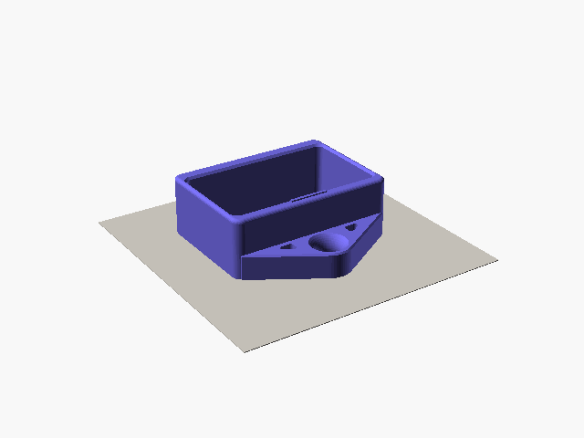
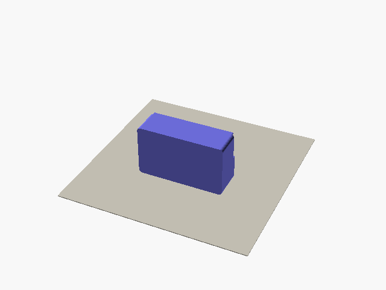
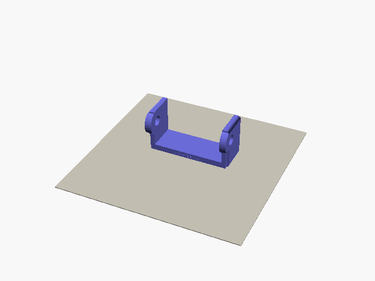
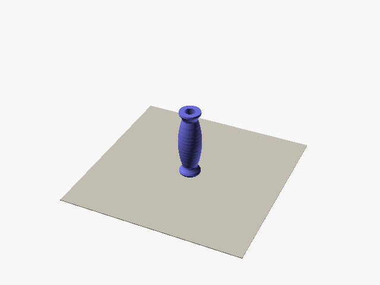
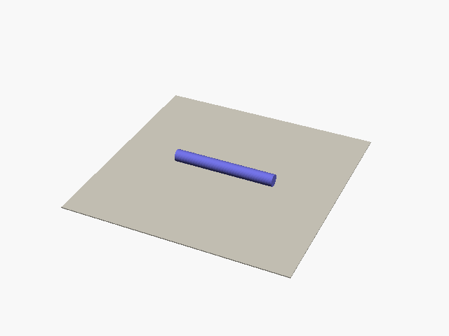
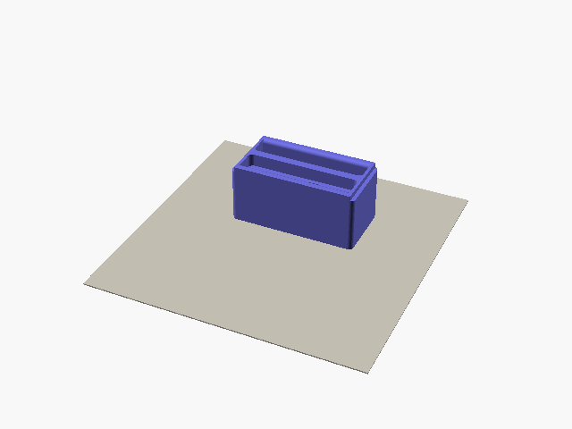

# Printing opengrips

These settings are where I'd start. They aren't load-tested yet, so read the note in the [README](README.md) first.

## Material

Print everything in PETG. PLA gets brittle in the cold and slowly bends when it's warm, say in a car on a sunny day.

## Settings

| Part | Walls | Infill |
| --- | --- | --- |
| Housing, edge, pocket and two-sided inserts, roller frame | 3 | 15% gyroid |
| Roller | 3 | 20% |
| Printed axle | 4 | 100% |

Use a 0.4 mm nozzle and 0.2 mm layers. These parts take your whole pull, so don't go below these settings to save time.

The anchor plate under the housing carries the whole pull through the walls around its hole. In your slicer, put a modifier on the plate and give it 100% infill.

## Which way up

Each part has one right way up. It keeps the load running along the layers and the grip smooth. The files from the configurator already sit this way, so you only need to slice them.

| Part | On the bed | Supports |
| --- | --- | --- |
| Housing | On its front, anchor plate flat on the bed | None |
| Edge, pocket or two-sided insert | On its back, front up | None |
| Roller frame | Upright, floor down | None |
| Roller | Standing on one end | None |
| Printed axle | Lying down | None |

| Housing | Edge insert | Pocket insert |
| --- | --- | --- |
|  |  |  |

| Roller frame | Roller | Axle |
| --- | --- | --- |
|  |  |  |

| Two-sided insert |
| --- |
|  |

If you render a part yourself, add `-D for_print=true` to get it the right way up:

```sh
openscad -D 'part="housing"' -D for_print=true -o housing.stl opengrips.scad
```

## Grip texture

Pick a pattern and a strength for the grip, the roof of the slot. The rest of the insert stays smooth.

Lines, Knurl and Dots are part of the edge itself, so you slice the insert like any other part. Pockets and slopers don't get them.

| Pattern | Fine | Medium | Coarse |
| --- | --- | --- | --- |
| Lines: ridges along the lip | 0.3 mm high, 0.8 mm apart | 0.4 mm, 1 mm | 0.6 mm, 1.5 mm |
| Knurl: small pyramids | 0.3 mm high, 0.8 mm apart | 0.4 mm, 1 mm | 0.6 mm, 1.5 mm |
| Dots: small cones | 0.3 mm high, 1 mm apart | 0.4 mm, 1.5 mm | 0.6 mm, 2 mm |

Fuzzy, Cells and Marble are your slicer's fuzzy skin, inside a modifier over the grip. The download has extra files for them.

In Bambu Studio or Orca Slicer, open the `-bambu-orca.3mf` file instead of the insert STL. It holds the insert and the modifier, with the texture already set. Pick your printer and filament, then slice.

PrusaSlicer has Fuzzy only. Use the insert STL and the `-fuzzy-modifier.stl` file:

1. Load the insert and its fuzzy modifier together, as one object with two parts. Both files already sit in the same place.
2. Right-click the modifier part and change its type to modifier.
3. Add the fuzzy skin settings to the modifier and pick "All walls". The grip prints as the wall of a hole, so "Outside walls" misses it.
4. Set the thickness and point distance for the strength you picked.

| Strength | Thickness | Point distance |
| --- | --- | --- |
| Fine | 0.2 mm | 0.3 mm |
| Medium | 0.3 mm | 0.5 mm |
| Coarse | 0.4 mm | 0.8 mm |

## How much filament

I sliced the default parts in PrusaSlicer 2.9.6 with the settings above, PETG at 1.27 g/cm³, and no supports. Nothing has been weighed after a real print yet.

| Part | Filament |
| --- | --- |
| Housing | 90 g |
| Edge insert, 20 mm | 87 g |
| Pocket insert, three-finger | 88 g |
| Two-sided insert, 20 and 10 mm edges | 87 g |
| Roller frame | 41 g |
| Roller, unlevel | 25 g |
| Roller, straight | 30 g |
| Printed axle | 17 g |

A housing and one edge insert come to about 180 g, so a 1 kg spool gets you a housing and about ten inserts.

## The fit test

On a new printer, print the fit test before the kit. In the configurator, click "Fit test" under Test prints, in the Download section. You get one zip with two small parts, already the right way up. Use the housing settings above.

- The ring is a thin slice of the front of the housing, with the lips, and the frame is a thin slice of the front of an insert. Push the frame into the back of the ring until it stops on the lips. It must slide in without force.

If it sticks, follow step 3 below, then print the fit test again.

## The texture test

To choose a grip pattern, print the texture test. In the configurator, click "texture test" under Download. You get one zip with two plates, already the right way up. Use the insert settings above.

- `texture-test.stl` has Lines, Knurl and Dots. Any slicer prints it.
- `texture-test-bambu-orca.3mf` has Fuzzy, Cells and Marble, with the fuzzy skin already set on each tab. Open it in Bambu Studio or Orca Slicer.

Each tab stands upright, like the grip of an insert on its back, so the pattern prints the same way. The front row is a smooth tab, to compare. Then each row is one pattern, Fine, Medium and Coarse from the left. The label in front of each tab says which: F, M or C.

Press a finger pad on the front of each tab and drag it down, the way your fingers load the grip. Pick the one that holds best without hurting, then pick that pattern and strength for your inserts.

## Checking the fit

1. Slide the insert into the housing from the back. It should stop on the lips at the front, and click over the stop at the back.
2. Press the stop down and push the insert out the back. It should come out without a fight.
3. If it sticks, look at the face that was on the bed. A flared first layer, the "elephant's foot", is the usual cause. Trim or sand that edge, or turn on elephant-foot compensation in your slicer.

## Before your first session

- Look for split layers at the anchor, at the lips, at the stop and at the grip. Don't use a cracked part.
- Hang the block from the carabiner and load it slowly by hand before you pull hard.
