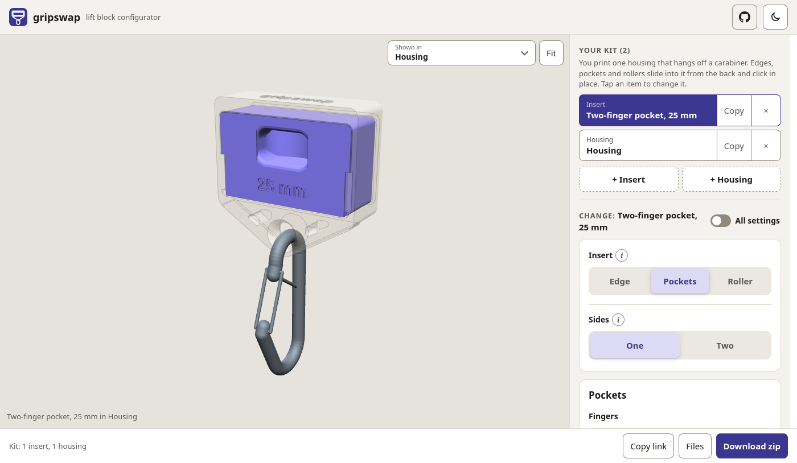

<div align="center">
  
  <h1>gripswap</h1>
  <p>A lift block for finger training that you can print yourself, with grips you swap by hand. Think of a portable hangboard.</p>
  <p>
    <a href="https://awalvie.github.io/gripswap/">Configurator</a> ·
    <a href="PRINTING.md">Printing guide</a> ·
    <a href="TODO.md">To do</a> ·
    <a href="https://github.com/awalvie/gripswap/issues">Issues</a>
  </p>
</div>

gripswap is a lift block for finger training. One housing hangs off a carabiner, and the grips slide into it from the back and click in place: edges, pockets and rollers.

You can build your own at [awalvie.github.io/gripswap](https://awalvie.github.io/gripswap/). Pick your grips, change the depth and the shape, and download the files. It all runs in your browser, and the page link keeps your kit, so you can bookmark it or share it.


This is a prototype, and I haven't load-tested it yet. Print and use it at your own risk, check it before every session, and stop using any part that cracks.

## What you can make

- Edges from 6 to 25 mm deep: flat, ergo, incut up to 20°, or slopers down to 45°.
- Two-sided inserts: any edge or pocket insert can get a second grip on its underside. Each grip is a flat, ergo or incut edge (up to 10°) or a row of pockets, 6 to 25 mm deep. Turn the insert over to switch.
- Pockets: mono, two-finger, three-finger, or up to three side by side.
- Rollers: unlevel or straight.
- A grip texture: resin or rock, made by your slicer to feel like a real board, marble from your slicer, or dots, lines and knurl in the edge itself, each fine, medium or coarse. A small test print has all of them, so you can feel them first.
- An anchor plate under the front of the housing, with a hole for the carabiner.

The anchor holds the carabiner right under the grip, so the edge should stay level when you pull. I haven't measured that yet.



## Printing

Print everything in PETG. The housing stands on its front, the inserts go on their backs, and the roller frame stands upright. The files you download already sit that way. A housing and one edge insert take about 180 g of filament.

The [printing guide](PRINTING.md) has the settings, which way up each part goes, and how to check the fit.

## You'll also need

- A steel screwgate carabiner, and a loading pin or sling for the weights.
- For the roller, a 12 mm steel rod or dowel as the axle, or you can print one.

## Putting it together

1. For the roller, drop it between the cheeks and push the axle through.
2. Slide the insert into the housing from the back until it clicks over the stop in the floor. When you pull, two lips at the front hold it.
3. To swap it, press the stop at the back of the floor down and push the insert out the back, with your fingers in the slot. To use the other grip of a two-sided insert, turn it over and slide it back in.
4. Clip the carabiner to the anchor under the housing.

## Working on it

The model is plain OpenSCAD, in `gripswap.scad` and `src/`. You can set any parameter from the command line:

```sh
openscad -D 'part="insert_edge"' -D slot_d=15 -o edge.stl gripswap.scad
```

To run the configurator locally, start `python3 web/server.py` and open http://localhost:8000. `web/catalog.py` lists what it offers.

`python3 tools/check_parts.py` renders every preset and the extremes of each setting, and checks that the parts still hold together. It also checks that an edge insert, a two-sided insert both ways up, and a roller insert at each diameter fit the housing: the lips and the stop hold them, and nothing else touches. It needs OpenSCAD, Node.js, and Python with trimesh and manifold3d, or run `nix develop` to get them all. Add `-e native` to skip the Node.js renderer.

If you find a problem or print one, [open an issue](https://github.com/awalvie/gripswap/issues).

## License

The design is under [CERN-OHL-S-2.0](LICENSE). The configurator runs a copy of [OpenSCAD](https://openscad.org/) in the browser, which is GPL-2.0; see `web/static/vendor/openscad/`.
